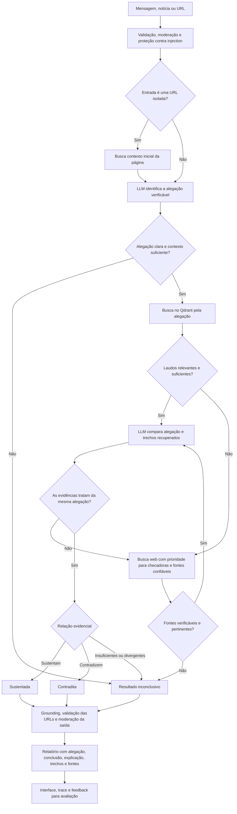

# Estado e roadmap do projeto

Este documento registra o que mudou no `checa-ai-factcheck-service`, o fluxo
evidencial atualmente implementado, as validações realizadas e as próximas
etapas acordadas para o projeto.

## Objetivo atual

O serviço recebe uma mensagem, notícia ou URL, identifica uma alegação factual
verificável e procura evidências para classificá-la como `sustentada`,
`contradita` ou `inconclusiva`. Similaridade vetorial é usada somente para
recuperação; ela não representa probabilidade de verdade ou falsidade.

O campo `probabilistic_assessment` permanece vazio. TF-IDF e BERTimbau não são
carregados pelo endpoint porque não atingiram os critérios de generalização e
calibração definidos na avaliação externa.

## Evolução em relação ao fluxo anterior

| Antes | Estado atual |
| --- | --- |
| A mensagem completa era usada diretamente na recuperação. | Uma LLM identifica e normaliza primeiro a alegação verificável. |
| Mensagens vagas podiam alcançar o RAG. | Falta de alegação ou de contexto essencial produz `inconclusiva` antes da recuperação. |
| O fluxo era orientado principalmente à geração de um desmentido. | A conclusão é ternária: `sustentada`, `contradita` ou `inconclusiva`. |
| Similaridade podia ser confundida com confiança na veracidade. | A pontuação vetorial é interna e serve apenas para selecionar candidatos. |
| Coincidência temática podia influenciar a conclusão. | A síntese deve conferir entidade, ação, data, local e negação relevantes. |
| O fallback web não tinha o mesmo contrato de fontes do RAG local. | Fontes locais e web possuem título, domínio, URL, trecho relevante e origem. |
| A geração podia citar referências fora do contexto recuperado. | URLs não recuperadas são rejeitadas pelo grounding. |
| Saída inválida da LLM podia produzir um veredito indevido. | Falha de JSON fecha o fluxo como `inconclusiva`. |
| Prompt e execução não tinham a mesma rastreabilidade. | Extração e síntese possuem versão, hash, fallback local e integração com Langfuse. |
| Não havia validação humana reproduzível do fluxo completo. | Há casos, respostas capturadas, revisão e relatório com decisão explícita. |

## Fluxo atual

Estados operacionais e conclusões permanecem separados:

- `matched`: a conclusão usou fontes locais;
- `deep_searched`: o fallback web foi executado;
- `abstained`: não houve base suficiente para concluir;
- `blocked`: uma proteção de segurança interrompeu o processamento.

Esses estados não equivalem a verdadeiro ou falso.

## Entregas concluídas

- Serviço independente com contrato Pydantic e endpoint `POST /api/debunk`.
- Extração estruturada da alegação para mensagem, notícia e URL.
- Recuperação pelo Qdrant e fallback web estruturado.
- Proteção contra prompt injection em entrada e evidências.
- Grounding de URLs e exposição somente das fontes efetivamente usadas.
- Proteção contra correspondência de mesmo tema sobre pessoa, data ou evento
  diferente.
- Interface com alegação identificada, conclusão, nível, explicação, fontes e
  feedback.
- Prompts de extração e síntese com versão, hash, fallback local auditável e
  suporte ao Langfuse.
- Avaliação offline de TF-IDF e BERTimbau, sem integração à produção.
- Cinco smokes E2E reais aprovados: fonte local favorável, contradição via web,
  mensagem vaga, URL isolada e indisponibilidade da busca externa.
- Qdrant Docker validado com uma coleção E2E dedicada. O índice de referência
  `fact_checks_pt_v2_openai`, criado com `text-embedding-3-small` e dimensão
  1536, permaneceu em modo somente leitura.
- Avaliação humana reproduzível de 20 casos.

## Resultado da avaliação humana

Decisão registrada: `approved_by_owner_with_exceptions`, aprovada por `leo`.

| Dimensão | Resultado | Critério |
| --- | ---: | ---: |
| Extração da alegação | 100,0% | >= 90% |
| Pertinência das fontes | 93,3% | >= 90% |
| Correção da conclusão | 95,0% | >= 90% |
| Correção da abstenção | 85,7% | >= 95% |
| Grounding das citações | 86,7% | 100% |

A aprovação permite avançar para um piloto controlado. As exceções de abstenção
e grounding permanecem documentadas e devem ser acompanhadas durante o piloto;
elas não foram removidas nem convertidas em aprovação automática.

## Próximos passos

### 1. Consolidar a entrega atual

- Revisar e versionar apenas código, testes, templates e documentação.
- Manter fora do Git chaves, ambientes virtuais, caches, logs, respostas com
  conteúdo potencialmente sensível, pesos e datasets locais.
- Publicar as mudanças por branch e pull request antes de atualizar `main`.

### 2. Preparar um piloto controlado

- Executar o serviço com Qdrant persistente e coleção explicitamente definida.
- Ativar no Langfuse as versões de prompt que foram validadas.
- Usar `LANGFUSE_CAPTURE_CONTENT=false` quando não houver autorização para
  armazenar o conteúdo das mensagens.
- Liberar o fluxo por feature flag ou para um grupo reduzido de usuários.
- Acompanhar feedback negativo, abstenções e respostas `contradita` com fontes
  web, preservando as exceções conhecidas.

### 3. Integrar ao backend

- Trabalhar em um repositório próprio ou fork do backend, preservando o remoto
  de referência.
- Criar um adapter HTTP para `POST /api/debunk` com timeout e tratamento de
  indisponibilidade.
- Manter `inconclusiva` como resultado válido, sem convertê-la em erro.
- Definir processamento assíncrono quando a recuperação e a busca web excederem
  o tempo aceitável da conversa.
- Apresentar ao usuário a conclusão, a explicação e as fontes utilizadas.

### 4. Operação e acompanhamento

- Monitorar saúde, latência, erros dos provedores, uso do fallback web e custo.
- Associar feedback a `trace_id` sem expor segredos ou conteúdo além da política
  de privacidade escolhida.
- Registrar novos casos representativos encontrados no piloto para futuras
  avaliações, sem bloquear o início desta etapa já aprovada pelo responsável.

### 5. Evoluções futuras e condicionais

- Corrigir ou ampliar a avaliação evidencial quando o piloto revelar padrões de
  erro relevantes.
- Reconsiderar NLI somente se houver volume significativo de erros na relação
  entre alegação e evidência.
- Retomar um classificador probabilístico somente após obter dados recentes,
  auditáveis e representativos e um candidato que passe nos gates de qualidade e
  calibração.
- Adotar MLflow quando houver um novo ciclo real de treinamento e promoção de
  modelos. DVC permanece responsável pelo versionamento de dados e Langfuse pela
  observabilidade do RAG/LLM.

## Fora do escopo atual

- Exibir porcentagem de chance de uma mensagem ser falsa.
- Usar similaridade vetorial como confiança factual.
- Colocar TF-IDF ou BERTimbau no endpoint.
- Introduzir NER, NLI ou uma arquitetura multiagente sem evidência de ganho.
- Alterar os repositórios remotos usados somente como referência.

